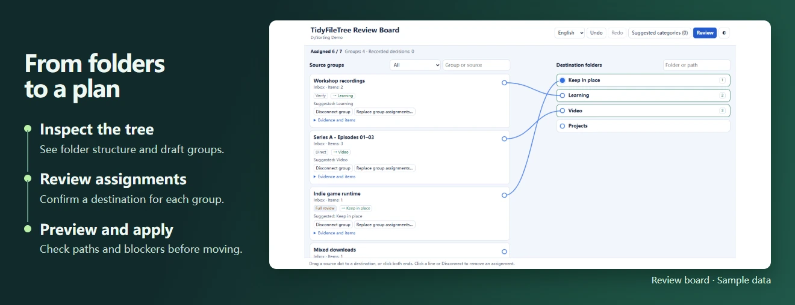

<div align="center">
  <br>
  
</div>
<p align="center"><a href="README.md">简体中文</a> | English</p>
<p align="center">
  <a href="https://www.python.org/downloads/"></a>
  <a href="LICENSE"></a>
  <a href="https://github.com/yeye45/tidy-file-tree/actions/workflows/ci.yml"></a>
  <a href="https://yeye45.github.io/tidy-file-tree/en.html"></a>
</p>

**Organize files by directory structure. Review the plan before moving anything.**

TidyFileTree is an open-source organizer for download folders, software collections, and media libraries. It gathers structural and naming clues to help you or an AI agent identify file groups, inventory units, and suggest destinations. Confirm assignments in a browser board, then review a preview receipt before applying moves or renames. The journal supports undo and recovery after interruption.

[Project site](https://yeye45.github.io/tidy-file-tree/en.html) · [Quick start](#quick-start) · [Try sample data](#try-sample-data) · [Workflow guide](FLOW.md) · [Agent instructions](SKILL.md)

[](site/assets/readme-workflow-en.webp)

## Quick start

Requires Python 3.9 or later. Windows PowerShell users can also use the wrappers in `scripts/`. When upgrading from an earlier version installed through pip, uninstall that package first.

```bash
git clone https://github.com/yeye45/tidy-file-tree.git
cd tidy-file-tree
python -m pip install .
tidy-file-tree --lang en --help
```

### Try sample data

Open the review board with fictional sample data.

```powershell
$demo = New-Item -ItemType Directory -Path ("tidy-file-tree-demo-" + [guid]::NewGuid())
python tests/make_fixture.py $demo.FullName
tidy-file-tree ui (Join-Path $demo.FullName "root") --lang en --open
```

## Organize your files

1. **Inspect folders.** Run `tidy-file-tree scan "D:\ToSort" --tree` to open the read-only interactive directory tree (with free pan/zoom, collapsible wide branches, and on-demand drill-down) and review folder types and episode drafts.
2. **Set the scope, inventory, and track progress.** Use `tidy-file-tree setup ask <directory>` to confirm your goal (organizing vs. reclaiming disk space), category preferences, and protected paths, then save answers with `tidy-file-tree setup apply <directory> answers.json`. Give your AI agent [SKILL.md](SKILL.md) to record probes, inventory units, and group related items. Run `tidy-file-tree progress <directory>` anytime for a live S0–S6 dashboard and next-step guidance, and `tidy-file-tree coverage <directory>` to check for omissions.
3. **Confirm destinations.** Run `tidy-file-tree decisions <directory>` and `tidy-file-tree ui <directory> --open`. Connect groups and node-level decisions to destinations (protected/skipped folders are surfaced transparently), review the evidence, and download the actions table.
4. **Preview and apply.** Generate a browser preview and JSON receipt first.

```powershell
tidy-file-tree apply "D:\ToSort" --actions tidy-file-tree-actions.tsv --dry-run --preview-html plan.html --receipt plan.tidy-file-tree-receipt.json
```

Open `plan.html` to check the source paths, final destinations, and blockers. Once you've approved the changes, apply them with the same receipt.

```powershell
tidy-file-tree apply "D:\ToSort" --actions tidy-file-tree-actions.tsv --receipt plan.tidy-file-tree-receipt.json
```

You can then browse pre-move folders in the **History Explorer** to see where items went, review the action log, or preview undoing the last batch:

```powershell
# Generate offline history.html (includes both History Explorer and Action Log views)
tidy-file-tree history "D:\ToSort" --open

# Or start a local live History Explorer (supports 1-click Reveal in Explorer & live existence checks)
tidy-file-tree history "D:\ToSort" --serve

# Preview undoing the last batch
tidy-file-tree undo --journal "D:\ToSort\_organize\journal.tsv" --last --dry-run
```

You approve the file operations. The preview receipt checks source identity and final destinations.

## Features

| Feature | Purpose |
| --- | --- |
| Interactive directory tree | Pan, zoom, and progressively drill down in a read-only tree showing folder types and episode drafts |
| Live stage dashboard | `progress` tracks S0–S6 completion, coverage, protected skips, and next-step hints in real time |
| AI review and browser board | Export questions, import answers, confirm groups and node-level decisions, and inspect protected skips |
| Preview, apply, and journal | Preview path changes and blockers, then verify with a JSON receipt before applying |
| History Explorer and undo | Browse historical pre-move folders like a file manager to trace multi-hop/parent-move destinations; `--serve` adds 1-click Reveal in Explorer, plus full undo and recovery |
| Multi-layer safety guardrails | `NO_TOUCH` / `WORKSPACE` / `FOREIGN` / `SECRET` markers, `--allow-system-drive` system-drive guards, toolchain/env protection, and explicit action tables |
| Chinese and English UI | Switch languages across the board, tree, dashboard, and history views, or pass `--lang en` |

## More detail

See the [workflow guide](FLOW.md), [agent instructions](SKILL.md), [feedback guide](FEEDBACK.md), and [limits and safety notes](#limits-and-safety-notes). Cross-volume examples, receipt details, the actions table format, and advanced recovery notes are in the section below.

<details>
<summary>Advanced operations and safety boundaries</summary>

### AI review, protection markers, and system drives

`tidy-file-tree decisions <directory> --need-ai` exports groups that need review. Use `--answers` to import responses. From the browser tree, you can export AI questions with conflicts and sample filenames, then import answers at the corresponding nodes. Write protection markers (`NO_TOUCH`, `WORKSPACE`, `FOREIGN`, `SECRET`) via `tidy-file-tree markers <directory> --action add ...` or `scripts/markers.ps1`. Targeting a system drive root (such as `C:\`) requires `--allow-system-drive` and isolates state under `%LOCALAPPDATA%`.

### Preview receipts and HTML preview

`--receipt` records source identity and final destinations during preview. Apply must use the same JSON receipt. Blockers, changed sources, or changed destinations stop the run before file moves begin. Store receipts in an existing working directory and use a new filename for each preview. Add `--preview-html plan.html` to create a browser preview.

### Actions table

The table has four tab-separated columns, `op`, `src`, `dst`, and `reason`. For `move`, `dst` is a destination folder. For `rename`, it is a new filename. For `mkdir`, it is an absolute path. To split a directory, inventory the units and confirm their destinations before generating individual moves.

### Cross-volume moves

Cross-volume moves support local fixed NTFS volumes on Windows. The destination must exist on a different volume. Explicitly authorize its root in both commands.

```powershell
tidy-file-tree apply "D:\Sort" --actions actions.tsv --allow-cross-drive --destination-root "E:\Archive" --dry-run --receipt cross.json
tidy-file-tree apply "D:\Sort" --actions actions.tsv --allow-cross-drive --destination-root "E:\Archive" --receipt cross.json
```

The PowerShell wrapper accepts `-AllowCrossDrive -DestinationRoot`. The tool verifies a staged copy before publishing it and checking the original. Reparse points, hard links, alternate data streams, extended attributes, or permission mismatches stop the move; a same-name destination also blocks it.

### Limits and safety notes

- Filenames and directory structure are the main evidence; image and audio/video content are not analyzed.
- Deletion is not a standalone action. Credential markers, protected areas, links, and reparse points block affected operations.
- The journal is not a backup. If objects changed externally or their state cannot be proven, inspect them manually.
- Windows PowerShell 5.1/7 have integration coverage; macOS/Linux have not been validated on real systems.
- Large scans may take time. Damaged or incomplete files are flagged but not repaired.
- Failure checks cover process interruption and simulated write failures, not real power loss or hardware damage.

</details>

## Tests and feedback

Run tests with `python -B -m unittest discover -s tests -v`. Classification examples are in [baseline](cases/baseline.json).

See the [feedback guide](FEEDBACK.md) before reporting an issue. The redacted summary is generated locally and is not uploaded; you choose what to submit.

## License

[MIT](LICENSE)
