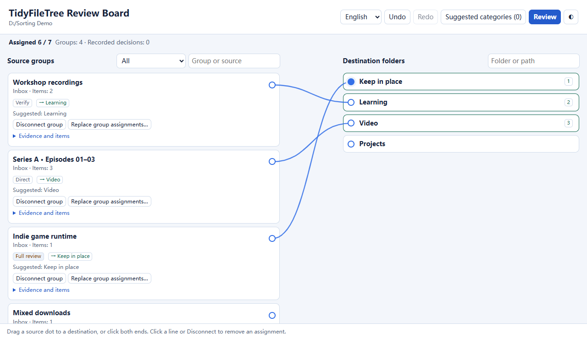

# TidyFileTree

[简体中文](README.md) · English

**Organize files by directory structure. Review the plan before moving anything.**

TidyFileTree is an open-source file organizer for download folders, media libraries, and software collections. A game's launcher and resource folders can stay together, while episodes spread across folders can be checked against each other by number.

Local tools collect structural evidence. An AI agent can use it to identify what belongs together, suggest destinations, and flag uncertain cases. Review the proposed assignments in an offline browser board, preview the file actions, then apply them with the same preview receipt. The journal supports undo and recovery.

[Project site](https://yeye45.github.io/tidy-file-tree/en.html) · [Install](#install) · [Try the review board](#try-the-review-board) · [Organize your own files](#organize-your-own-files)

[](site/assets/board-en.png)

The screenshot uses fictional folders.

## Install

Requires Python 3.9 or later. If you installed the previous `packtidy` package through pip, uninstall it with `python -m pip uninstall packtidy` before installing.

```bash
git clone https://github.com/yeye45/tidy-file-tree.git
cd tidy-file-tree
python -m pip install .
tidy-file-tree --lang en --help
```

The `packtidy` command remains available as an alias. Windows is the platform with the most complete end-to-end testing. Cross-volume moves currently support local fixed NTFS volumes on Windows.

## Try the review board

Run these PowerShell commands from the checkout to create a fresh set of fictional files and open the board. You can try assigning groups and reviewing a plan using the sample data. The fixture includes Chinese group labels to demonstrate how the board displays source text.

```powershell
$demo = New-Item -ItemType Directory -Path ("tidy-file-tree-demo-" + [guid]::NewGuid())
python tests/make_fixture.py $demo.FullName
tidy-file-tree ui (Join-Path $demo.FullName "root") --lang en --open
```

Use the language selector at the top of the board to switch between English and Simplified Chinese. The language setting covers the board's controls, review text, and CLI help. Paths, category labels, evidence, and AI responses appear as supplied. Some underlying command messages are currently in Chinese.

## Organize your own files

### Live directory tree scan

Run `tidy-file-tree scan "D:\ToSort" --tree` to open a live directory tree in your browser. Nodes branch from left to right and show the scan status and folder type. Types come from immediate directory structure and naming evidence, with uncertain types marked as candidates. This read-only view supports human or AI review and leaves directory sizes uncalculated.

After scanning, files with explicit season and episode numbers appear in an episode inventory draft. When episodes from the same season are spread across sibling folders, their parent shows a grouping draft with the source and proposed destination of each video and matching subtitle. If the parent is the series folder, the draft suggests moving the files up one level. Otherwise, it suggests a series folder under the shared parent. Name conflicts, duplicate episodes, and ambiguous subtitles are flagged for review. You can download the drafts as JSON. The move preview displays paths only.

`--depth N` sets the maximum scan depth (default 3). The page indicates when a sampling limit is reached. Use `--lang en` for the English interface, and press `Ctrl+C` to stop the local server.

```powershell
tidy-file-tree scan "D:\ToSort" --tree --depth 4 --lang en
```

1. **Set the scope.** Run `tidy-file-tree setup ask "D:\ToSort"` to see the setup questions. Record protected folders and files before inspecting the directory. See the [workflow guide](FLOW.md) and [agent instructions](SKILL.md).
2. **Inspect and group.** Start with `tidy-file-tree scan "D:\ToSort" --json` to inspect structural signals. The agent reads the task instructions, then records its findings in `_organize/probe/`.
3. **Review the destinations.** Run `tidy-file-tree decisions "D:\ToSort"`, then `tidy-file-tree ui "D:\ToSort" --lang en --open`. Assign the confirmed groups or items, then download the actions table.
4. **Preview, then apply.** Use the same receipt for both commands. The first command previews the actions. Run the second after you review the preview.

```powershell
tidy-file-tree apply "D:\ToSort" --actions tidy-file-tree-actions.tsv --dry-run --receipt plan.tidy-file-tree-receipt.json
tidy-file-tree apply "D:\ToSort" --actions tidy-file-tree-actions.tsv --receipt plan.tidy-file-tree-receipt.json
```

### Preview in the browser

Add `--preview-html plan.html --lang en` to the dry-run command and open `plan.html` in your browser. Review proposed source paths, expected destinations, parent directories to be created, and preflight blockers. When using a receipt, pass the same JSON receipt to the apply command.

### View execution history

Run `tidy-file-tree history "D:\ToSort" --lang en --open` to review a timeline by batch, path, or journal number. Each entry shows recorded paths and stages and links related undo and redo operations. Run the command again to refresh the offline snapshot.

To preview undoing the last run, use:

```powershell
tidy-file-tree undo --journal "D:\ToSort\_organize\journal.tsv" --last --dry-run
```

## Feedback

If a grouping looks wrong, share a small synthetic directory tree, the destination you expected, and what the tool suggested. See [the feedback guide](FEEDBACK.md) for the local redaction script.

## License

[MIT](LICENSE)
