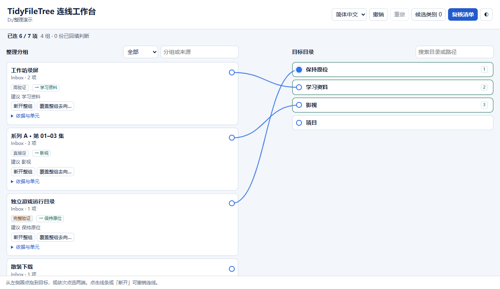

# TidyFileTree

简体中文 · [English](README.en.md)

**按目录结构整理文件。先预览，确认后再移动。**

TidyFileTree 是面向下载目录、软件合集和媒体库的开源文件整理工具。比如，同一部剧散落在两个目录时，可以按集数核对后归组；游戏的启动程序、依赖和数据目录可以作为一个整体保留。

本地工具收集目录结构线索，AI 代理据此判断目录用途、清点单元、归组并建议去向。你在浏览器工作台里连线确认，再用预演清单核对即将发生的移动或改名。执行日志可用于撤销和中断恢复。

[项目网站](https://yeye45.github.io/tidy-file-tree/) · [安装](#安装) · [试用工作台](#试用连线工作台) · [整理自己的文件](#整理自己的文件) · [完整流程](FLOW.md)

[](site/assets/board-zh.png)

截图使用虚构样本。

## 安装

需要 Python 3.9 或更新版本。当前版本安装后使用 `tidy-file-tree` 命令。

如果先前用 pip 安装过 `packtidy`，先运行 `python -m pip uninstall packtidy`。

```bash
git clone https://github.com/yeye45/tidy-file-tree.git
cd tidy-file-tree
python -m pip install .
tidy-file-tree --help
```

也可以直接运行 `python tidy_file_tree.py`。Windows 用户可使用 `scripts/` 中的 PowerShell 封装，支持 Windows PowerShell 5.1 和 PowerShell 7。

新版也提供 `packtidy` 兼容命令，可以继续读取原有规则、整理日志和连线记录。

### 语言

连线工作台右上角可在简体中文和英语之间切换。也可以在生成时指定初始语言。

```powershell
tidy-file-tree --lang en --help
tidy-file-tree ui "D:\待整理" --lang en --open
```

语言设置覆盖工作台控件、复核清单和命令帮助。文件名、分类标签、规则依据和 AI 回填内容按原文显示，底层命令的执行信息目前主要为中文。

## 快速体验

选择一个已有目录，查看文件类型、连续编号或程序布局等线索。下面是 Windows 路径示例。

```powershell
tidy-file-tree scan "D:\待整理" --json
```

### 浏览器目录树扫描

运行 `tidy-file-tree scan "D:\ToSort" --tree`，在浏览器打开实时目录树。节点从左到右按目录层级展开，显示扫描状态和文件夹类型。判断依据来自本层结构和命名线索，证据不足的类型会标为候选。这是供人工或 AI 复核的只读视图，目录大小显示为未统计。

扫描完成后，带有明确季号和集号的文件会生成剧集清点草稿。同剧同季分在同一上级下的多个目录时，上级节点会显示归组草稿。展开可查看视频和匹配字幕的原路径及建议目标。如果上级就是剧名目录，草稿建议直接上提一级，否则建议归入上级下的剧名子目录。重名、重复集号、字幕配对不明确等情况会标记待确认。草稿可下载为 JSON，移动预演只展示路径。

扫描结束后，标为「待确认」的归组草稿会自动生成 AI 复核问题。点 **导出 AI 复核问题** 下载 JSON，里面有冲突说明、集号和命名分布，以及每组最多 8 个代表性文件名。来源目录以编号表示。把问题文件交给自己的 AI 代理，再用 **导入 AI 回答** 在对应节点查看猜想、验证过程和结论，审批仍由用户完成。重新扫描时，当前标签页会保留草稿未变化的回答。关闭页面后，可以重新导入保存的答案文件。

`--depth N` 设置最大扫描深度（默认 3），`--lang en` 切换为英语。达到取样上限时，页面会注明。按 `Ctrl+C` 关闭本机页面服务。

```powershell
tidy-file-tree scan "D:\ToSort" --tree --depth 4 --lang en
```

### 试用连线工作台

在项目目录运行下面的 PowerShell 命令，生成一份虚构样本并打开工作台。可以练习连线、改变去向和查看复核清单。

```powershell
$demo = New-Item -ItemType Directory -Path ("tidy-file-tree-demo-" + [guid]::NewGuid())
python tests/make_fixture.py $demo.FullName
tidy-file-tree ui (Join-Path $demo.FullName "root") --open
```

## 整理自己的文件

1. **确定整理范围。** 用 `tidy-file-tree setup ask <目录>` 查看需要确认的分类偏好和保护路径，用 `tidy-file-tree setup apply <目录> answers.json` 保存答案。先登记工作区、他人文件和凭据的保护标记。
2. **判断哪些文件该一起处理。** 让 AI 代理按 [SKILL.md](SKILL.md) 做探针、清点和归组。软件和它的运行资源可以计作一个单元，互不相关的下载文件可以逐项处理。阶段记录存入 `_organize/probe/`，用 `tidy-file-tree coverage <目录>` 查漏。
3. **在工作台确认去向。** 运行 `tidy-file-tree decisions <目录>` 生成建议，再运行 `tidy-file-tree ui <目录> --open`。把左侧分组或单元连到右侧目标，查看证据后下载动作表。可执行条目须有明确去向，并能与清点记录核对。
4. **先预演，再执行。** 按下方示例用 `--dry-run --receipt` 写出预演清单。核对后，去掉 `--dry-run`，使用同一份清单执行。完成后可按日志撤销，中断时用 `recover` 检查和恢复。

### AI 判断与保护标记

- 用 `tidy-file-tree decisions <目录> --need-ai` 导出待判断的组，交给 AI 代理补充依据，再用 `--answers` 回填。有待判断的组时，命令会输出 JSON 并返回退出码 1。工作台可显示验证级别、规则依据和已回填的判断。 [AI 复核流程](FLOW.md#ai-介入)
- 用 `scripts/markers.ps1` 把保护写入 `_organize/markers.tsv`。常见标记有 `NO_TOUCH`（明确保留）、`WORKSPACE`（正在整理）、`FOREIGN`（他人资料）和 `SECRET`（凭据）。 [标记用法](SKILL.md#标记用户会忘所以文件得记住)

### 预演与执行示例

假设你已下载并核对 `tidy-file-tree-actions.tsv`，在它所在的目录执行。第二条命令会按动作表移动或改名。

```powershell
tidy-file-tree apply "D:\待整理" --actions tidy-file-tree-actions.tsv --dry-run --receipt plan.tidy-file-tree-receipt.json
tidy-file-tree apply "D:\待整理" --actions tidy-file-tree-actions.tsv --receipt plan.tidy-file-tree-receipt.json
```

要预演撤销最近一批操作，可以运行 `tidy-file-tree undo --journal "D:\待整理\_organize\journal.tsv" --last --dry-run`。核对撤销内容后，去掉 `--dry-run` 执行。

### 图形预演

在预演命令末尾加 `--preview-html plan.html`，然后在浏览器打开 `plan.html`。页面显示拟执行的来源、预计最终落点、可能需要新建的父目录，以及预检拦截项。搭配 `--receipt` 使用时，正式执行仍需传入同一份 JSON 清单。

### 查看执行历史

运行 `tidy-file-tree history "D:\待整理" --open`，按批次、路径或日志编号查看执行时间线。每项显示已记录的原路径、落点和状态，撤销与重做可以跳回关联操作。页面是主日志的离线快照，重新运行命令即可刷新。

## 动作表格式

`tidy-file-tree plan <目录> --dry-run` 根据探针和 `_organize/policy.json` 预览可批准的动作。`--policy` 可以覆盖审批设置并追加禁区。重新生成计划时，如果没有可批准的动作，已有的 `plan.tsv` 会被更新为空表。

`--receipt` 在预演时将源身份和最终落点写入一个新 JSON 文件，在正式执行时核对同一份清单。发现拦截项、源被替换或最终落点变化时，整份清单会在启动文件移动前停止。清单请放在现有工作目录里，重新预演时换一个文件名。

审批完成后用四列 TSV 执行。`move` 的 dst 是目录，`rename` 的 dst 是新文件名，
`mkdir` 的 dst 是绝对路径（各列必须用制表符分隔）：

```
op      src                     dst                     reason
move    /mnt/disk/下载/课程      /mnt/disk/学习           用户已批准
rename  /mnt/disk/新建文件夹     照片备份                 已确认内容
mkdir   -                       /mnt/disk/归档           下载暂存区拆分
```

也支持 PowerShell 封装：

```powershell
pwsh -File scripts/apply.ps1 -Root G:\ -Actions actions.tsv -DryRun -Receipt plan.tidy-file-tree-receipt.json
pwsh -File scripts/apply.ps1 -Root G:\ -Actions actions.tsv -Receipt plan.tidy-file-tree-receipt.json
pwsh -File scripts/undo.ps1 -Journal journal.tsv -Last -DryRun
pwsh -File scripts/recover.ps1 -Root G:\
```

**`split` 不会自动展开**——必须先按最小单元归组、生成明确的动作表。
理由见 `references/judgment.md`：按扩展名拆分必然拆散引擎资源。

### 显式跨卷移动

动作表中的 `move` 目标必须是另一卷上已存在的目录。执行时同时传入开关和已授权的目标根。可重复指定目标根。

```powershell
tidy-file-tree apply "D:\整理区" --actions actions.tsv --allow-cross-drive --destination-root "E:\归档区" --dry-run --receipt cross.tidy-file-tree-receipt.json
pwsh -File scripts/apply.ps1 -Root "D:\整理区" -Actions actions.tsv -AllowCrossDrive -DestinationRoot "E:\归档区" -Receipt cross.tidy-file-tree-receipt.json
```

工具会验证暂存副本再发布目标，随后隔离原件并逐项复核后清理。恢复和撤销仍用源整理根及其日志。跨卷目标已有同名对象会拦截。发布前中断时，原件仍在原路径，暂存副本留在目标根的 `_organize/cross-volume`。

## 目录结构

```
tidy_file_tree.py           统一入口（scan/coverage/plan/apply/undo/recover/ui）
SKILL.md                    流程与规则
policy.example.json         自动批准策略示例（复制为 policy.json 后按你的盘改）
core/
  executor.py               执行、撤销、事务恢复；PowerShell 共用此实现
  safety.py                 路径、保护标记及链接检查
  signals.py                可代码化的判据 → 输出事实 JSON
  coverage.py               覆盖检查：有没有节点被跳过
  decisions.py              S4 建议：每组该去哪，含新建分类的归属规划
  ui.py                     读取阶段产物，生成连线工作台
  wire_ui.html              随安装包提供的离线界面模板
  cross_volume.py           跨卷暂存、校验及原件清理
references/
  probe-task.md             S1 判定任务
  unit-inventory.md         S2 清点任务
  grouping-task.md          S3 归组任务
  judgment.md               信号 → 单元数的判断规则
scripts/
  apply.ps1                 执行（经 journal）
  undo.ps1                  逆序撤销
  recover.ps1               恢复未完成操作或镜像中完整的日志后缀
  common.ps1                Python 调用桥接
  journal.ps1               日志
  markers.ps1               标记（FOREIGN/WORKSPACE/SECRET…）
  peek_archive.py           读压缩包条目表（不解压）
  export-feedback.py        本地生成脱敏摘要（不联网、不上传）
```

## 安全设计

**先记录后修改。** `journal.tsv` 保留八列追加式 TSV，操作先写 pending、完成后写 done。
reason 列使用 JSON 保存人工依据、事务编号、文件身份和逆操作关联。
`_organize/transactions/` 与本机镜像同时保存可恢复的引用变更；中断时禁止继续修改，先运行 recover。
每个日志路径有独立的本机镜像目录，避免不同盘的记录混在一起。

**按操作状态撤销。** 撤销通过原始 seq 关联日志，重复撤销跳过已经撤销的项；对撤销产生的 run 再执行 undo 即可重做。
文件对象已被替换或修改时保留现场；冲突不覆盖。原有八列日志仍可读取/列出，但缺少身份信息的旧动作不会被自动撤销。
`undo -Seq N` 仅选择编号不大于 N 的原始正向动作，不把历史撤销/重做再次混入范围；需要重做时指定撤销产生的 RunId 或使用 Last。
保护标记的双写也有独立恢复记录。写入中断或主标记缺失时会阻止后续整理，`recover` 会完成已记录的更新或从镜像补回主标记。

**删除从不作为单独动作生成。** 跨卷移动只清理可核对且目标副本已验证的原件。

**凭据隔离。** `SECRET` 标记的文件及其父目录不移动，拦截结果不输出凭据路径；NOTE 不能解除保护。
`setup` 保存的 `no_go_zones` 也受保护，可使用根目录内的绝对路径或相对根目录的路径。
源、目标及沿途目录的链接、Junction、重解析点都会被拒绝，目录内部包含这些项也不能整体移动。
凭据可能藏在任何地方——随机名目录、备份归档深处、微信年月子目录。
建议把凭据扫描当独立步骤，不靠探针顺带发现。

## 已知限制

- **扫描证据以文件名和目录结构为主。** 照片画面、音视频对白等内容需要额外的识别工具。
- **跨平台尚未完整验证。** Windows PowerShell 5.1/7 已做集成测试，macOS/Linux 接口未实机验证。
- **跨卷对象限制。** 当前支持 Windows 本地 NTFS 固定磁盘。跨卷移动接受可保真的普通文件和目录，遇到重解析点、硬链接、备用数据流、扩展属性或权限不匹配会停止。会核对可查询权限，审计 SACL 不在保真范围。
- **日志不是备份。** 对象被外部替换、日志历史分歧或其他无法证明的状态需要人工核对，不猜测恢复。
- **故障验证范围。** 测试覆盖进程中断和模拟写入失败；没有做真实断电、硬件损坏或外置盘强制拔出测试，不承诺硬件故障下的完整恢复。
- **并发边界。** 同一根目录的工具操作共用锁；整理期间应暂停其他会修改同一路径的下载、同步或手工操作。工具不会覆盖竞争出现的目标。
- **大目录慢。** 几十万文件的目录，`signals.py` 可能要跑几分钟。
- **不检测损坏。** 截断的文件、不完整的分卷，只标记不修复。

## 测试

工作台可以导出人工纠正的分类样本。参考 [分类基准](cases/baseline.json) 记录期望去向，再运行 `tidy-file-tree verify run <本地用例.json>`。

```bash
python -B -m unittest discover -s tests -v
```

包含信号、路径别名、保护标记、嵌套覆盖、引用同步、执行/撤销/重做、日志故障和中断恢复的合成目录测试；有 PowerShell 时也实际验证脚本入口。

## License

MIT
