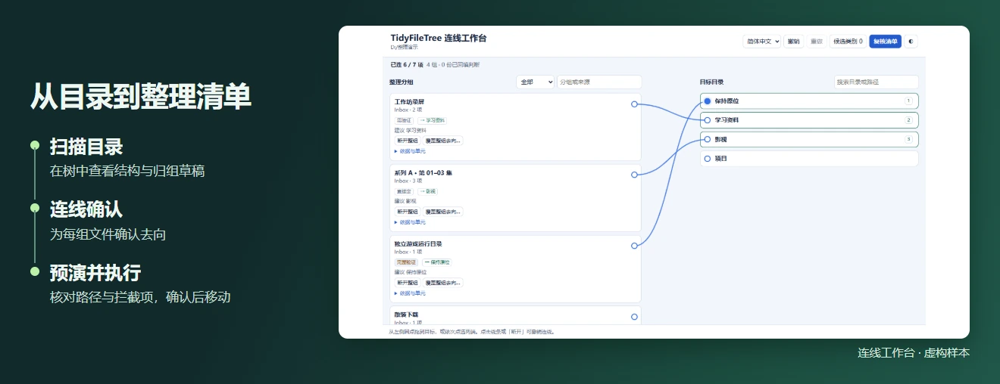

<div align="center">
  <br>
  
</div>
<p align="center">简体中文 | <a href="README.en.md">English</a></p>
<p align="center">
  <a href="https://www.python.org/downloads/"></a>
  <a href="LICENSE"></a>
  <a href="https://github.com/yeye45/tidy-file-tree/actions/workflows/ci.yml"></a>
  <a href="https://yeye45.github.io/tidy-file-tree/"></a>
</p>

**按目录结构整理文件。先预览，确认后再移动。**

TidyFileTree 是面向下载目录、软件合集和媒体库的开源整理工具。它收集目录结构与命名线索，帮助你或 AI 代理识别文件用途、归组并建议去向。你可以在浏览器工作台确认去向，预演移动或改名，并用执行日志撤销或恢复操作。

[项目网站](https://yeye45.github.io/tidy-file-tree/) · [快速开始](#快速开始) · [试用样本](#试用样本) · [完整流程](FLOW.md) · [使用说明](SKILL.md)

[](site/assets/readme-workflow-zh.webp)

## 快速开始

需要 Python 3.9 或更新版本。Windows PowerShell 用户也可使用 `scripts/` 封装。从旧版升级时，请先卸载原来用 pip 安装的软件包。

```bash
git clone https://github.com/yeye45/tidy-file-tree.git
cd tidy-file-tree
python -m pip install .
tidy-file-tree --help
```

### 试用样本

用虚构样本体验连线工作台。

```powershell
$demo = New-Item -ItemType Directory -Path ("tidy-file-tree-demo-" + [guid]::NewGuid())
python tests/make_fixture.py $demo.FullName
tidy-file-tree ui (Join-Path $demo.FullName "root") --open
```

## 整理流程

1. **查看目录。** 运行 `tidy-file-tree scan "D:\ToSort" --tree`，在浏览器查看只读交互式目录树（支持自由缩放、拖动、宽分支折叠、按需逐级下钻展开）、目录类型与剧集草稿。
2. **确定范围、清点与追踪进度。** 用 `tidy-file-tree setup ask <目录>` 查看目标（整理归类 vs 清理腾空间）、分类偏好及保护路径的问题，再用 `tidy-file-tree setup apply <目录> answers.json` 保存答案。让 AI 代理按 [SKILL.md](SKILL.md) 记录探针、单元清点与归组结果；过程中可随时运行 `tidy-file-tree progress <目录>` 查看 S0–S6 实时进度看板与下一步建议，并用 `tidy-file-tree coverage <目录>` 查漏。
3. **选去向并查看预演。** 运行 `tidy-file-tree decisions <目录>` 和 `tidy-file-tree ui <目录> --no-open`。从实时进度页点「打开连线工作台」，在左侧选择要整理的项目，在右侧点选目标文件夹，再点「查看预演」。未选去向的项目留在原位。
4. **核对并确认。** 预演页会列出每项操作的来源、预计落点和拦截原因。核对通过后，在当前整理对话中确认执行这份预演。

独立操作时，也可以用 `tidy-file-tree ui <目录> --open` 打开离线工作台，下载动作表，再用下面的命令生成预演和核对清单。

```powershell
tidy-file-tree apply "D:\ToSort" --actions tidy-file-tree-actions.tsv --dry-run --preview-html plan.html --receipt plan.tidy-file-tree-receipt.json
```

打开 `plan.html` 核对原路径、最终落点和拦截项，确认后使用同一份清单执行。

```powershell
tidy-file-tree apply "D:\ToSort" --actions tidy-file-tree-actions.tsv --receipt plan.tidy-file-tree-receipt.json
```

执行后可以打开**历史文件管理器**（按整理前的旧目录结构一层层浏览文件现在去哪了）或操作日志，也可以预演撤销最近一批操作：

```powershell
# 生成离线 history.html（内置「历史文件管理器」与「操作日志」双视图）
tidy-file-tree history "D:\ToSort" --open

# 或启动本地实时历史文件管理器（支持一键在系统资源管理器中定位现位置）
tidy-file-tree history "D:\ToSort" --serve

# 预演撤销最近一批操作
tidy-file-tree undo --journal "D:\ToSort\_organize\journal.tsv" --last --dry-run
```

审批由你完成。预演清单会核对源文件身份和最终落点。

## 功能一览

| 功能 | 用途 |
| --- | --- |
| 交互式目录判断树 | 自由缩放、拖动与逐级下钻展开，用目录和文件名线索识别候选类型与剧集草稿 |
| 实时分阶段进度看板 | `progress` 实时展示 S0–S6 阶段进度、覆盖率、受保护跳过计数与下一步提示 |
| AI 协作与连线工作台 | 导出问题、导入回答，可视化拍板分组与单目录决策，透明展示受保护跳过项 |
| 预演、执行与记录 | 预览路径变化与拦截项，使用同一份 JSON 清单核对后执行 |
| 历史文件管理器与回滚 | 像资源管理器一样浏览整理前的旧目录，追踪多跳/父目录迁移现位置；`--serve` 支持一键在资源管理器定位，并可随时撤销或中断恢复 |
| 多层安全护栏 | `NO_TOUCH` / `WORKSPACE` / `FOREIGN` / `SECRET` 标记、系统盘 `--allow-system-drive` 保护、工具链/环境变量防护与显式动作表 |
| 中英文界面 | 工作台、目录树、进度看板与历史页均支持中英文切换，也可用 `--lang en` 启动 |

## 深入使用

查看 [完整流程](FLOW.md)、[代理规则](SKILL.md)、[反馈指南](FEEDBACK.md) 和 [限制与安全说明](#限制与安全说明)。跨卷示例、receipt 细节、动作表格式及高级恢复说明见下方折叠章节。

<details>
<summary>高级操作与安全边界</summary>

### AI 复核、保护标记与系统盘模式

`tidy-file-tree decisions <目录> --need-ai` 导出待判断组，使用 `--answers` 回填。浏览器扫描树也可导出带冲突和命名样例的 AI 问题，再把回答导入对应节点。保护标记可通过 `tidy-file-tree markers <目录> --action add ...` 或 `scripts/markers.ps1` 写入 `_organize/markers.tsv`，包括 `NO_TOUCH`、`WORKSPACE`、`FOREIGN` 和 `SECRET`。整理系统盘根目录（如 `C:\`）时需显式传入 `--allow-system-drive`，运行状态会安全隔离写入 `%LOCALAPPDATA%` 而非污染系统盘根目录。

### 预演清单与 HTML 预览

`--receipt` 在预演时写出源身份和最终落点，正式执行必须使用同一份 JSON。遇到拦截项、源被替换或落点变化时，会在移动开始前停止。清单放在现有工作目录，每次重新预演使用新文件名。加 `--preview-html plan.html` 可生成浏览器预览。

### 动作表

动作表使用制表符分隔的四列 `op`、`src`、`dst`、`reason`。`move` 的 `dst` 是目标目录，`rename` 使用新文件名，`mkdir` 使用绝对路径。拆分目录时，先清点最小单元和确认每组去向，再生成具体的移动动作。

### 跨卷移动

跨卷移动支持 Windows 本地固定 NTFS 卷。目标必须是另一卷上已存在的目录，预演和执行时都要显式授权目标根。

```powershell
tidy-file-tree apply "D:\Sort" --actions actions.tsv --allow-cross-drive --destination-root "E:\Archive" --dry-run --receipt cross.json
tidy-file-tree apply "D:\Sort" --actions actions.tsv --allow-cross-drive --destination-root "E:\Archive" --receipt cross.json
```

也可使用 `scripts/apply.ps1` 的 `-AllowCrossDrive -DestinationRoot`。工具先验证暂存副本，再发布目标并核对原件。重解析点、硬链接、备用数据流、扩展属性或权限不匹配会停止；目标同名对象会拦截。

### 限制与安全说明

- 文件名与目录结构是主要证据；不分析照片画面或音视频内容。
- 删除不是独立动作；凭据标记、保护区、链接和重解析点会阻止相关操作。
- 日志不是备份。对象被外部修改或状态无法证明时，需要人工核对。
- Windows PowerShell 5.1/7 已做集成测试；macOS/Linux 尚未实机验证。
- 大目录扫描可能较慢；工具标记损坏或不完整文件但不修复。
- 故障测试覆盖进程中断和模拟写入失败，未验证真实断电或硬件损坏。

</details>

## 测试与反馈

运行测试：`python -B -m unittest discover -s tests -v`。分类样本见 [baseline](cases/baseline.json)。

反馈前请查看 [反馈指南](FEEDBACK.md)。脱敏摘要在本地生成，不会联网或上传；是否提交由你手动决定。

## License

[MIT](LICENSE)
